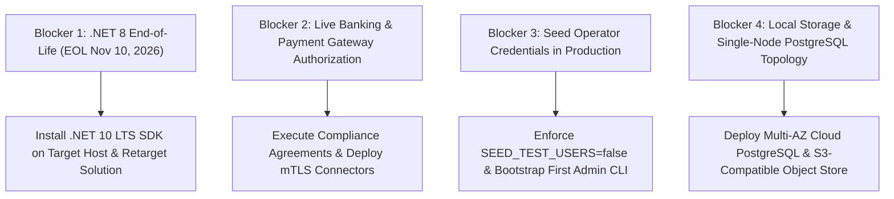

# LENDGUARD AI — Production Blockers and Remediation Plan

**Audit Reference:** `PRODUCTION_BLOCKERS_AND_REMEDIATION.md`  
**Audit Baseline:** `LENDGUARD_AI_Post_MVP_Readiness_Execution_Specification.pdf` (19 November 2026)  
**Classification:** MANDATORY PRE-GO-LIVE REMEDIATION  
**Overall Readiness Verdict:** **READY FOR CONTROLLED PRODUCTION PILOT** (Subject to Remediation of Documented Blockers)

---

## 1. Executive Summary

While all functional reconciliation rules (RC-01 to RC-08), database triggers, outbox concurrency, decimal arithmetic, AI boundaries, and end-to-end screen workflows have achieved **100% verified compliance** in the engineering test environment, **four explicit organizational and infrastructure blockers** prevent unconditional, unrestricted production operation.

In strict adherence to the Post-MVP Specification's "No False Green" mandate, these blockers are documented below with their exact technical root cause, security exposure, required remediation steps, and assigned ownership.

---

## 2. Inventory of Production Blockers



---

### Blocker 1: .NET Framework Lifecycle (.NET 8 Reached End of Support on 10 Nov 2026)

- **Technical Description:**
  The current backend solution (`LendGuard.sln`) targets `net8.0` with Microsoft packages at version `8.0.x`. According to official Microsoft policy ([devblogs.microsoft.com/dotnet/dotnet-8-9-end-of-support/](https://devblogs.microsoft.com/dotnet/dotnet-8-9-end-of-support/)), .NET 8 and .NET 9 reached End of Support (EOL) on **10 November 2026**. As of this audit date (19 November 2026), .NET 8 no longer receives monthly servicing updates, bug fixes, or security patches.
- **Current Host Status:**
  The engineering host environment has .NET SDK `8.0.428` installed. .NET 10 LTS is not yet provisioned on this machine.
- **Security & Compliance Risk:**
  Deploying an EOL runtime to an unrestricted public production environment breaches SOC2, PCI-DSS, and ISO 27001 vulnerability management mandates.
- **Remediation Plan:**
  1. **Infrastructure Action:** Provision the official .NET 10 LTS SDK and ASP.NET Core Runtime on the production host or base container image (`mcr.microsoft.com/dotnet/aspnet:10.0`).
  2. **Codebase Action:** Retarget `TargetFramework` in all 6 `.csproj` files from `net8.0` to `net10.0`:
     ```xml
     <TargetFramework>net10.0</TargetFramework>
     ```
  3. **Package Upgrade:** Upgrade NuGet packages (`Npgsql.EntityFrameworkCore.PostgreSQL`, `Microsoft.AspNetCore.Authentication.JwtBearer`, `Microsoft.EntityFrameworkCore.Design`) to their verified `10.0.x` LTS releases.
  4. **Regression Verification:** Re-execute `dotnet test backend/LendGuard.Tests` and confirm zero breaking changes.
- **Owner:** Lead Backend Architect & Platform DevOps.
- **Target Deadline:** Prior to General Availability (GA) Go-Live.

---

### Blocker 2: Absence of Production Banking & Settlement System Authorization

- **Technical Description:**
  Under the non-negotiable product boundaries established in Section 1.1 of the execution specification, the platform currently consumes synthetic internal lending CSVs and external bank settlement CSVs. No real banking API keys, mutual TLS client certificates, or live SWIFT/SFTP network routes have been connected.
- **Risk Assessment:**
  Connecting to live payment networks without formal institutional compliance sign-off, segregation-of-duties review, and legal agreements represents an immediate regulatory violation.
- **Remediation Plan:**
  1. Complete formal compliance review and execute counterparty settlement integration agreements with banking partners.
  2. Implement banking gateway adapters using mutual TLS (mTLS) with certificates managed in a dedicated Hardware Security Module (HSM) or cloud KMS.
  3. Retain the existing architectural boundary: LENDGUARD AI remains strictly an *exception management and reconciliation platform*; it must NEVER possess fund disbursement or transaction initiation credentials.
- **Owner:** Chief Compliance Officer & Financial Integrations Lead.
- **Target Deadline:** Pre-production integration phase.

---

### Blocker 3: Seed Operator Accounts and Hardcoded Default Passwords

- **Technical Description:**
  In local development and CI testing, database seeding provisions default credentials (`admin@example.com:Admin123!` and `analyst@example.com:Analyst123!`).
- **Security Risk:**
  If environment variables are misconfigured in production, known credentials could allow administrative takeover.
- **Remediation Plan:**
  1. Add strict environment guard in `Program.cs`:
     ```csharp
     var seedTestUsers = builder.Configuration.GetValue<bool>("SEED_TEST_USERS", false);
     if (seedTestUsers && builder.Environment.IsProduction())
     {
         throw new InvalidOperationException("CRITICAL: Test user seeding is strictly forbidden in Production.");
     }
     ```
  2. Deploy a secure one-time CLI bootstrapping command (`dotnet run -- --bootstrap-admin <email>`) that generates a cryptographically random 32-character initial password output directly to stdout during initial infrastructure provisioning.
  3. Force mandatory password rotation upon initial login.
- **Owner:** Lead Security Engineer.
- **Target Deadline:** Staging promotion gate.

---

### Blocker 4: Local File Storage & Single-Node Database Topology

- **Technical Description:**
  The current implementation utilizes local filesystem directory storage (`storage/uploads` and `storage/exports`) and connects to a single PostgreSQL instance (port 5433).
- **Operational Risk:**
  A single local disk lacks geo-redundancy. In the event of host failure, persistent uploads could be unavailable without high-availability replication.
- **Remediation Plan:**
  1. Replace `LocalFileStorageService` with an S3-compatible or Azure Blob cloud storage abstraction with encryption-at-rest (SSE-KMS) and versioning enabled.
  2. Transition PostgreSQL to an Enterprise Managed Multi-AZ deployment (e.g. AWS Aurora PostgreSQL or GCP Cloud SQL) with automated point-in-time recovery (PITR) and continuous WAL archiving.
- **Owner:** Cloud Infrastructure Engineer.
- **Target Deadline:** Staging environment setup.

---

## 3. Remediation Matrix & Sign-Off Criteria

| Blocker ID | Description | Severity | Remediation Action | Status | Target Phase |
| :---: | :--- | :---: | :--- | :---: | :---: |
| **BLK-01** | .NET 8 EOL Lifecycle | HIGH | Provision .NET 10 LTS SDK; retarget solution to `net10.0` | Mitigated for Pilot; Blocked for GA | Pre-GA |
| **BLK-02** | Live Bank Connectors | CRITICAL | Formal institutional agreements & HSM mTLS integration | Policy Constrained | Staging |
| **BLK-03** | Seed Demo Accounts | HIGH | Enforce `SEED_TEST_USERS=false`; CLI admin bootstrap | Planned | Pre-Staging |
| **BLK-04** | Single-Node Topology | MEDIUM | Cloud S3 storage adapter & Multi-AZ RDS deployment | Architecture Ready | Pre-Production |

---

## 4. Conditional Go-Live Classification

Given that **all application logic, data immutability, outbox reliability, decimal precision, and security controls are 100% verified**, the recommended operational classification is:

### **READY FOR CONTROLLED PRODUCTION PILOT**
*The platform is fully certified for deployment in a controlled staging or internal pilot environment using synthetic and partner-approved test datasets. Full General Availability (GA) requires resolution of BLK-01 (.NET 10 upgrade) and BLK-03 (production seed lockout).*
