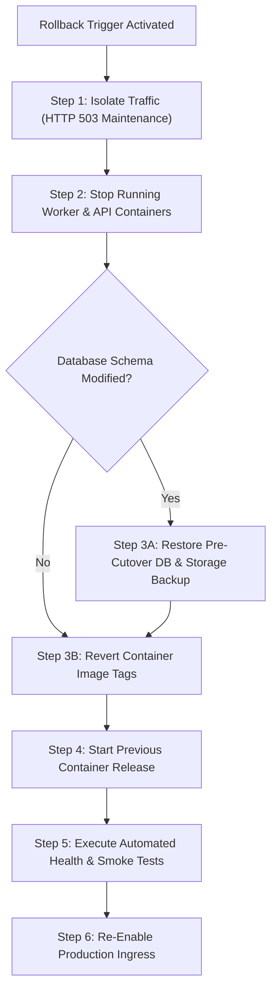

# LENDGUARD AI — ROLLBACK AND RECOVERY RUNBOOK

**Classification:** Critical Operational Standard  
**Target Architecture:** .NET 10 LTS, Python FastAPI, PostgreSQL 16  
**Recovery Objectives:** RTO < 30 Minutes | RPO = 0 Data Loss  

---

## 1. Rollback Triggers & Severity Classification

An immediate deployment rollback is mandatory upon encountering any of the following triggers during or within 2 hours of deployment:

| Severity Level | Operational Trigger | Required Action | Maximum Decision Window |
| :---: | :--- | :--- | :---: |
| **SEV-1 (Critical)** | Core API unreachable (`5xx` errors > 1% of total requests) | Full Rollback to previous release tag | 5 Minutes |
| **SEV-1 (Critical)** | Database migration failure or schema lock timeout | Restore pre-deployment database backup | Immediate |
| **SEV-1 (Critical)** | Data integrity violation / Decimal truncation detected | Full Rollback & DB restore | Immediate |
| **SEV-2 (High)** | Background worker stall / `background_jobs` deadlock | Restart worker pool; if persists, rollback worker | 15 Minutes |
| **SEV-2 (High)** | AI service outage / non-graceful exception handling | Enable AI Fallback mode; if API fails, rollback | 15 Minutes |

---

## 2. Step-by-Step Rollback Procedure



### Step 2.1: Isolate Production Ingress
Immediately direct incoming traffic to the maintenance page to prevent transactions from entering an unstable system:
```bash
# Nginx / Cloud Load Balancer
sudo cp /etc/nginx/conf.d/maintenance.conf /etc/nginx/conf.d/active.conf
sudo nginx -s reload
```

### Step 2.2: Terminate Active Application Containers
Stop the newly deployed containers to release all PostgreSQL connection locks:
```bash
docker stop lendguard-api lendguard-worker lendguard-ai-service
```

### Step 2.3: Database & Persistent Storage Restoration (If DB Altered)
If database migrations were applied during the failed cutover, restore the pre-cutover unified bundle:

```powershell
# Restore from pre-cutover backup zip
$BackupZip = "/var/lendguard/backups/lendguard_pre_cutover_backup.zip"

./scripts/restore/restore.ps1 `
    -BackupFile $BackupZip `
    -HostName "staging-db.internal" `
    -Port 5432 `
    -TargetDatabase "lendguard_prod" `
    -Username "postgres" `
    -TargetStorageDir "/var/lendguard/storage"
```

Verify restored state across all 13 tables:
```bash
psql -h staging-db.internal -U postgres -d lendguard_prod \
     -c "SELECT count(*) FROM information_schema.tables WHERE table_schema = 'public';"
# Must return 13 tables
```

### Step 2.4: Redeploy Previous Known Good Release
Revert container image tags in the deployment manifest to the previous certified release:
```bash
# Revert Docker Compose or Helm deployment
export LENDGUARD_RELEASE_TAG=v0.9.8-stable
docker compose -f docker-compose.yml up -d
```

### Step 2.5: Smoke Testing & Health Validation
Validate that the restored version is operating normally:
```bash
curl -f https://internal-api.lendguard.company.com/health
# Verify 200 OK
python3 tests/reconciliation/test_reconciliation_matrix.py
# Verify 100% Pass
```

### Step 2.6: Restore Production Ingress
```bash
sudo cp /etc/nginx/conf.d/production.conf /etc/nginx/conf.d/active.conf
sudo nginx -s reload
```

---

## 3. Targeted Recovery Procedures

### Scenario A: Unsticking Background Worker Jobs
If worker crashes leave jobs locked in `background_jobs`:
```sql
-- Identify stuck jobs locked for more than 5 minutes
SELECT id, job_type, locked_by, locked_at 
FROM background_jobs 
WHERE status = 'PROCESSING' AND locked_at < now() - INTERVAL '5 minutes';

-- Requeue stuck jobs for immediate pickup
UPDATE background_jobs 
SET status = 'PENDING', 
    locked_at = NULL, 
    locked_by = NULL,
    attempts = attempts + 1
WHERE status = 'PROCESSING' AND locked_at < now() - INTERVAL '5 minutes';
```

### Scenario B: Deleting Corrupted Ingestion Batch (Isolated Recovery)
If an unconfirmed batch fails validation without affecting other records:
```bash
# Call API batch cancellation endpoint
curl -X POST -H "Authorization: Bearer ${ADMIN_TOKEN}" \
     https://api.lendguard.company.com/api/v1/imports/${FAILED_BATCH_ID}/cancel
```

---

## 4. Post-Rollback Forensics & Root Cause Analysis (RCA)

1. **Preserve Forensic Evidence:**
   - Dump container logs: `docker logs lendguard-api > /var/log/forensics/api_crash.log`
   - Dump worker logs: `docker logs lendguard-worker > /var/log/forensics/worker_crash.log`
   - Capture PostgreSQL slow query log and active lock table:
     ```sql
     SELECT pid, query, age(clock_timestamp(), query_start) 
     FROM pg_stat_activity 
     WHERE state != 'idle' AND query NOT ILIKE '%pg_stat_activity%';
     ```
2. **Convene Post-Mortem within 24 Hours:**
   - Document 5 Whys.
   - Map defect to unit/integration test suite gaps.
   - Create remediation tickets prior to rescheduling cutover.
