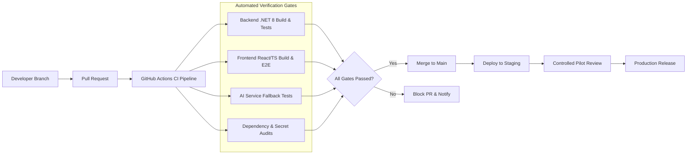

# LENDGUARD AI — CI/CD Pipeline & Controlled Release Process

## 1. Overview & Architecture

The LENDGUARD AI continuous integration and delivery architecture enforces rigorous automated verification gates before any code artifact or container image can be promoted to staging or production environments.

The pipeline ensures:
1. Complete deterministic unit and integration test execution.
2. Static typing and compile-time validation for C# and TypeScript.
3. Automated supply chain vulnerability scanning (`dotnet list package --vulnerable`, `npm audit`, `pip-audit`).
4. Secret detection and prevention of credential leakage.
5. Strict container tagging and immutable image hashes.

---

## 2. CI/CD Pipeline Workflow

---

## 3. Automated Quality Gates

| Gate ID | Stage | Tool / Command | Pass Criteria |
| :--- | :--- | :--- | :--- |
| **QG-01** | Backend Build | `dotnet build backend/LendGuard.sln -c Release` | 0 warnings, 0 compilation errors |
| **QG-02** | Backend Unit Tests | `dotnet test backend/LendGuard.Tests` | 100% pass (22/22 tests), 0 failures |
| **QG-03** | Backend Security | `dotnet list package --vulnerable` | 0 critical/high vulnerabilities |
| **QG-04** | Frontend Build | `npm run build` (tsc -b && vite build) | Clean bundle generation, 0 type errors |
| **QG-05** | Frontend Security | `npm audit --audit-level=high` | 0 vulnerabilities |
| **QG-06** | E2E Playwright | `npx playwright test` | 100% pass across all 18 screens and workflows |
| **QG-07** | AI Service Tests | `python test_ai_boundary_and_fallback.py` | 100% pass, fallback verified |
| **QG-08** | Secret Scan | `detect-secrets` or Gitleaks | 0 committed credentials / API keys |

---

## 4. Release Promotion Process

1. **Feature Branching:** Developers create feature branches `feat/*` or `fix/*` off `main`.
2. **Pull Request & CI:** PR triggers the GitHub Actions CI pipeline. All 8 quality gates must pass before merge approval.
3. **Staging Deployment:** Upon merge to `main`, Docker container images are built with immutable git commit SHA tags (`ghcr.io/org/lendguard-api:sha-xxxx`) and deployed to the staging environment.
4. **Staging Smoke & E2E Run:** Automated synthetic regression tests run against staging.
5. **Controlled Production Pilot:** Release is promoted to a controlled pilot environment restricted to designated internal users and synthetic workloads.
6. **Production Gate Sign-Off:** Final production release requires dual-control operational approval, .NET runtime verification, and documented change management tickets.
