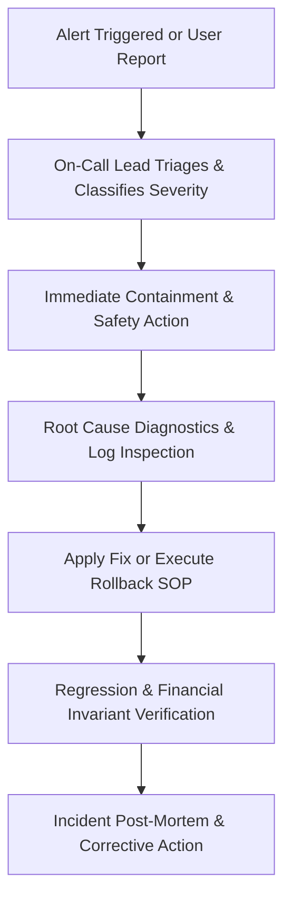

# LENDGUARD AI — Incident Response Runbook

## 1. Incident Classification & Severity Matrix

| Severity | Definition | Response SLA | Resolution SLA | Example Scenarios |
| :--- | :--- | :--- | :--- | :--- |
| **P1 - Critical** | Catastrophic system outage or financial integrity compromise | < 15 minutes | < 2 hours | Database down, API non-responsive, reconciliation producing corrupted output, suspected security breach. |
| **P2 - Major** | Core feature impaired with significant operational impact | < 30 minutes | < 6 hours | Background worker stalled, batch imports failing, AI service unresponsive with failing fallback. |
| **P3 - Minor** | Moderate degradation; business operations continue via workaround | < 2 hours | < 24 hours | Report export formatting error, slow query latency, single-user authentication glitch. |
| **P4 - Low** | Minor cosmetic defect or operational question | Next business day | Next sprint | Minor UI alignment, cosmetic typo in error description. |

---

## 2. Incident Response Workflow



---

## 3. Specific Operational Incident Runbooks

### Runbook 1: Financial Reconciliation Failure / Discrepancy Alert
**Trigger:** Reconciliation run status transitions to `FAILED` or mismatch in control totals.
1. **Immediate Action:** Do NOT rerun batches repeatedly. Freeze the batch pair in PostgreSQL.
2. **Diagnostic Commands:**
   ```bash
   # Check worker logs for unhandled exceptions or constraint violations
   grep "FAIL" /var/log/lendguard/worker.log
   # Query run failure details
   SELECT id, status, failure_code, failure_message FROM reconciliation_runs WHERE status = 'FAILED';
   ```
3. **Mitigation:**
   - If caused by database lock contention, verify `background_jobs` table for orphaned locks (`locked_at < NOW() - INTERVAL '10 minutes'`).
   - If caused by bad source CSV data, inspect `import_row_errors` for row-level parsing syntax failures.
4. **Resolution:** Rerun the batch only after underlying issue is identified and resolved. Batches cannot duplicate matches due to uniqueness constraints.

---

### Runbook 2: AI Service Outage / Provider Downtime
**Trigger:** Health check alert on `:8000/health` or backend HTTP 503 from AI client.
1. **Immediate Action:** The system automatically fails over to heuristic advisory mode. Verify that fallback banners are rendered on the UI.
2. **Diagnostic Commands:**
   ```bash
   # Check AI service daemon status
   curl -i http://localhost:8000/health
   # Check uvicorn process
   ps aux | grep uvicorn
   ```
3. **Mitigation:**
   - If AI container/process crashed, restart the daemon: `python -m uvicorn app.main:app --port 8000`.
   - If external LLM provider quota/key expired, verify `AI_PROVIDER_API_KEY` in environment. The platform will safely continue in heuristic mode without stopping core financial workflows.
4. **Attribution Policy:** Confirm that generated explanations are explicitly tagged with `is_fallback: true` and labeled "Heuristic Rule-Based Advisory".

---

### Runbook 3: Suspected Unauthorized Access / IDOR Breach
**Trigger:** Security alert, audit log anomaly, or repeated HTTP 403/401 spikes.
1. **Immediate Action:** Revoke compromised user sessions or API tokens.
   ```sql
   -- Immediately deactivate suspicious user account
   UPDATE users SET is_active = false WHERE email = 'compromised_analyst@example.com';
   -- Check audit log for accessed records
   SELECT event_action, entity_type, entity_id, ip_address, created_at 
   FROM audit_logs 
   WHERE user_id = 'compromised-guid' 
   ORDER BY created_at DESC;
   ```
2. **Investigation:** Verify record-level ownership checks in `ExceptionService.cs`. Verify that no cross-user modification occurred.
3. **Containment:** If token secret was leaked, execute emergency JWT rotation as per `SECRET_AND_JWT_ROTATION_PLAN.md`.

---

### Runbook 4: Database Disaster Recovery / Data Corruption
**Trigger:** Unrecoverable PostgreSQL disk corruption or hardware failure.
1. **Immediate Action:** Stop API and Worker services immediately to prevent dirty writes:
   ```powershell
   Stop-Process -Name "LendGuard*" -Force
   ```
2. **Execute Restore:**
   ```powershell
   .\scripts\restore\restore.ps1 -BackupFile "database\backups\latest_bundle.zip" -Port 5433 -TargetDatabase "lendguard"
   ```
3. **Verify Restored Integrity:**
   - Run `python tests/operations/test_disaster_recovery.py` against restored database.
   - Assert all 13 tables are intact with 0 record loss.
4. **Restart Services:** Start API and Worker daemons and run smoke tests.
