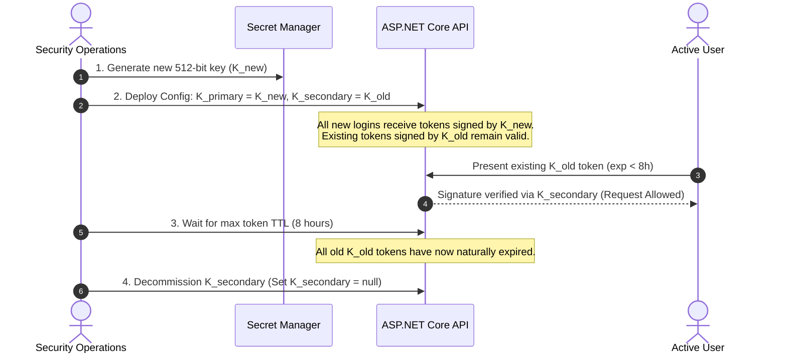

# LENDGUARD AI — Enterprise Secret Management & JWT Key Rotation Plan

**Document Reference:** `docs/security/SECRET_AND_JWT_ROTATION_PLAN.md`  
**Security Classification:** Highly Confidential / Engineering Operations  
**Compliance Alignment:** NIST SP 800-57, OWASP ASVS 4.0, PCI-DSS v4.0 Requirement 3

---

## 1. Executive Summary & Configuration-Driven Secret Management

LENDGUARD AI enforces strict segregation between source code and operational credentials. All development placeholder secrets are superseded by production-grade configuration injection via environment variables or cloud key vaults (AWS Secrets Manager / GCP Secret Manager / Azure Key Vault).

### 1.1 Environment Variable Hierarchy
The platform evaluates secrets following ASP.NET Core and FastAPI configuration precedence:
1. Container / Host Environment Variables (highest priority)
2. `appsettings.Production.json` / `.env.production`
3. Base `appsettings.json` (defaults to restricted placeholders only)

| Secret Key Name | Purpose | Minimum Entropy | Production Override Variable |
| :--- | :--- | :--- | :--- |
| **Database Connection** | PostgreSQL connection string | $\ge 256$ bits | `ConnectionStrings__DefaultConnection` |
| **JWT Secret Key** | HMAC-SHA256 signature key | $\ge 512$ bits | `JWT_SECRET` |
| **AI Microservice Key** | Mutual API authentication key | $\ge 256$ bits | `AI_SERVICE_KEY` |
| **OpenAI / Hosted LLM Key** | Hosted advisory LLM access | Standard API key | `OPENAI_API_KEY` |

---

## 2. Zero-Downtime JWT Secret Key Rotation Plan

To rotate JWT signing keys without forcefully terminating active user sessions or invalidating valid tokens, LENDGUARD AI employs a **Dual-Key Rotation Protocol** using the JWT `kid` (Key Identifier) header.

### 2.1 Dual-Key Verification Protocol
The ASP.NET Core Web API maintains an active keyring consisting of two keys:
- **Primary Signing Key ($K_{primary}$):** Used to sign all newly generated access tokens.
- **Secondary Verification Key ($K_{secondary}$):** Valid for signature verification only for previously issued tokens that have not yet expired.

### 2.2 Four-Step Rotation Procedure


---

## 3. Password Reset Token Security Specification

Password reset flows are a primary attack vector for account takeover. LENDGUARD AI implements defense-in-depth controls matching Section 4 table `password_reset_tokens`:

### 3.1 Cryptographic Entropy & Nonce Generation
- Generated via `RandomNumberGenerator.GetBytes(32)` providing 256 bits of cryptographically secure pseudo-random entropy.
- Raw token string: `Convert.ToHexString(bytes).ToLowerInvariant()`.

### 3.2 One-Way Hash Storage
- The raw reset token is **never** stored in the database.
- The database stores only the SHA-256 hash: `token_hash = SHA256(raw_token)`.
- If the database is compromised, reset tokens cannot be reconstructed or harvested.

### 3.3 Atomic Single-Use Semantics & TTL Expiration
- **Time-to-Live (TTL):** Strictly 15 minutes (`expires_at = now() + interval '15 minutes'`).
- **Single-Use Enforcement:** Password reset consumes the token within an atomic SQL transaction:
  ```sql
  UPDATE password_reset_tokens 
  SET used_at = now() 
  WHERE token_hash = @tokenHash 
    AND used_at IS NULL 
    AND expires_at > now();
  ```
- If `RowsAffected == 0`, the reset request is rejected with `INVALID_OR_EXPIRED_TOKEN`.

---

## 4. Web Security Controls (CSRF, CORS, Cookies & Headers)

1. **CORS Policy:** Strict origin restriction (`AllowOrigins`) in production targeting the verified reverse proxy or CDN domain. Wildcard origins (`*`) are prohibited in production.
2. **Cookie Security:** Refresh tokens and session identifiers enforce `HttpOnly`, `Secure` (HTTPS only), and `SameSite=Strict`.
3. **HTTP Strict Transport Security (HSTS):** Enforced with `max-age=31536000; includeSubDomains; preload`.
4. **Security Headers:**
   - `X-Content-Type-Options: nosniff`
   - `X-Frame-Options: DENY`
   - `Content-Security-Policy: default-src 'self'; script-src 'self'; style-src 'self' 'unsafe-inline';`
   - `Referrer-Policy: strict-origin-when-cross-origin`
