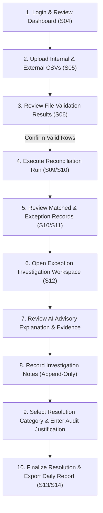

# LENDGUARD AI — Financial Analyst Standard Operating Procedure (SOP)

**Document Reference:** `docs/user-guides/ANALYST_STANDARD_OPERATING_PROCEDURE.md`  
**Role:** Financial Reconciliation Analyst (`ANALYST`)  
**Operational Objective:** Perform daily file ingestion, review deterministic matching results, investigate exceptions with AI advisory assistance, and record audited human resolutions.

---

## 1. Daily Workflow Overview

Financial analysts operate under the **Human-in-the-Loop Principle**:
- Reconciliation matching is 100% deterministic.
- AI analysis is strictly advisory.
- Every exception resolution requires human sign-off with mandatory categorization and audit justification.

---

## 2. Step-by-Step Operating Procedures

### Step 1: Ingesting Daily Files (Screen S05 & S06)
1. Navigate to **Imports** (`/imports`).
2. Click **Upload File**. Select the source type:
   - Choose `INTERNAL` for the loan repayment ledger CSV.
   - Choose `EXTERNAL` for the counterparty bank settlement statement CSV.
3. Once uploaded, the platform displays the **Validation Inspection Screen** (`/imports/:id/validation`):
   - Review total rows, valid rows, rejected rows, and duplicate rows.
   - If rejected rows exist, review the specific row numbers and error codes.
4. Click **Confirm Import** to stage the valid transactions into the ledger.

### Step 2: Triggering Reconciliation (Screen S09 & S10)
1. Navigate to **Reconciliation** (`/reconciliation-runs`).
2. Click **Start Reconciliation**.
3. Select the confirmed `Internal Batch` and the counterparty `External Batch`.
4. Click **Execute Run**. The background worker processes the run using deterministic rules `RC-01` to `RC-08`.
5. Once completed, inspect the summary cards:
   - **Matched Count:** Exactly matched or aggregate matched pairs.
   - **Exception Count:** Discrepancies requiring analyst review.

### Step 3: Working the Exception Queue (Screen S11)
1. Navigate to **Exceptions** (`/exceptions`).
2. Filter exceptions by:
   - `Exception Type`: `AMOUNT_MISMATCH`, `MISSING_SETTLEMENT`, `UNMATCHED_EXTERNAL`, `DUPLICATE`, `PARTIAL_SETTLEMENT`, `AMBIGUOUS_MATCH`.
   - `Severity`: `HIGH`, `MEDIUM`, `LOW`.
   - `Status`: `OPEN`, `IN_PROGRESS`, `RESOLVED`.
3. Click any exception row to open the **Investigation Workspace** (`/exceptions/:id`).

### Step 4: Investigating Discrepancies & AI Advisory (Screen S12)
1. Inspect the **Transaction Evidence Card**:
   - Compare the internal expected amount vs external settled amount.
   - Inspect transaction dates, references, and counterparty payment channels.
2. Review the **AI Advisory Insights Panel**:
   - The AI service analyzes transaction context and computes an anomaly score.
   - Read the advisory explanation and recommended review steps.
   - *Note:* The AI advice is supplementary context. You are empowered to agree, refine, or override the advice based on verified banking documentation.
3. Record notes in the **Investigation Notes** panel. Notes are permanent, append-only records stamped with your user ID and timestamp.

### Step 5: Resolving an Exception
1. Click **Resolve Exception**.
2. Select a valid **Resolution Category**:
   - `TIMING_DIFFERENCE_ACKNOWLEDGED`: Settlement received after cutoff; verified in next cycle.
   - `FEE_DEDUCTION_VERIFIED`: Counterparty withheld gateway fee or interchange charge.
   - `MANUAL_ADJUSTMENT`: Ledger adjusted under authorized financial policy.
   - `DATA_CORRECTION`: Source file data corrected and verified.
   - `FRAUD_DISPUTE_ESCALATED`: Suspicious activity escalated to risk team.
3. Enter a mandatory, detailed **Resolution Explanation** explaining the business rationale.
4. If your decision differs from the AI recommendation, check `Override AI Advisory`.
5. Click **Submit Resolution**. The exception transitions to `RESOLVED` and is logged to the immutable audit trail.
